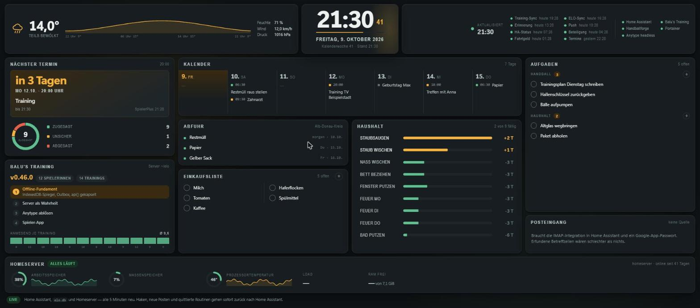

# Nebenschirm

*Full-screen glanceable dashboard for a spare monitor: calendar, weather,
shopping and task lists, waste-collection dates, chores, and home-server health.
A single-file Python data service (standard library only) reads Home Assistant,
a SQLite file and `/proc`; a dependency-free frontend renders one no-scroll page
and writes changes back to Home Assistant through a small whitelist.*

> Portfolio-Stand: interne Adressen sind durch Platzhalter ersetzt, echte
> Inhalte (Einkaufsposten, Termine, Token) liegen ausschließlich in der `.env`
> bzw. in Home Assistant und sind nicht Teil des Repositorys. Der README
> beschreibt Aufbau und Entscheidungen, nicht die Daten selbst.

---

Dashboard für einen zweiten Monitor neben dem Hauptbildschirm (Linux Mint,
2560 × 1440). Der Rechner läuft nur, wenn jemand am PC sitzt. Die Tafel geht
beim Anmelden im Vollbild auf, lässt sich aber mit F11 verlassen, weil der
Rechner nebenher normal benutzt wird.

**Kein Handball-Projekt.** Handball ist nur einer von mehreren Inhalten.

## Screenshots

<!-- docs/screenshot-*.png — Tafel im Vollbild, mit Demo-Werten -->



## Stand

**Live seit 19.08.2026, bedienbar seit 25.08.2026.** Die Tafel zieht ihre Werte
alle fünf Minuten aus Home Assistant, `elo.db` der Balu-App und vom Homeserver
selbst. Der Zeitpunkt der letzten Aktualisierung steht oben rechts neben der
Uhr und noch einmal unter dem Datum.

Seit dem Umbau am 25.08. schreibt sie auch zurück: Einkäufe und Aufgaben lassen
sich anklicken und ergänzen, Haushaltsroutinen quittieren — siehe „Bedienen".
Gleichzeitig hat sie ihre Gestaltung bekommen, die unter „Gestaltung und
Bewegung" steht.

`prototyp/index.html` ist der eingefrorene Gestaltungsentwurf vom 18.08.2026 und
wird nicht mehr gepflegt — er liegt nur als Referenz dabei.

## Aufbau

```
server.py     Datendienst am Homeserver (Port 8300), nur Standardbibliothek
static/       index.html + board.js — die Tafel selbst
deploy.sh     testet, lädt hoch, startet den Dienst neu
nebenschirm.service   systemd-User-Unit für den Homeserver
start-imac.sh   öffnet die Tafel am iMac im Vollbild (dort: ~/nebenschirm-start.sh)
firefox-user.js Firefox-Einstellungen am iMac (dort: ins Profilverzeichnis)
```

Der Dienst läuft **am Homeserver**, nicht am iMac. Gründe:

- Home Assistant und `elo.db` liegen dort, der Token bleibt auf dem Server und
  landet nie im Browser.
- Eine Seite von `file://` darf Home Assistant gar nicht abfragen (CORS). Kommt
  Seite und Daten von derselben Adresse, entfällt das Problem.
- Der iMac muss nichts installiert haben und holt nur eine URL ab.

```
GET  /            die Tafel
GET  /api/board   alle Werte als JSON  (?frisch=1 umgeht den 60-Sekunden-Cache)
GET  /api/ping    {"ok": true, "bau": "<Stempel>"} — siehe „Neu laden"
POST /api/aktion  abhaken, anlegen, Routine quittieren — siehe „Bedienen"
```

Fällt eine Quelle aus, liefert der Dienst die übrigen Werte trotzdem. Bricht der
Abruf ganz weg, bleibt im Browser der letzte Stand stehen und der Punkt neben
„Aktualisiert" wird rot — eine leere Tafel hilft niemandem.

## One-Pager

Auf 2560 × 1440 passt alles ohne Scrollen. Aufbau von oben nach unten:

1. **Kopfzeile** — Wetter links, Uhr mittig (Datum, Kalenderwoche, Stand),
   rechts der Aktualisierungszeitpunkt, die Cronjob-Punkte und — durch eine
   Linie getrennt — die fünf Dienste des Homeservers als Punkte.
2. **Vier Spalten**: Termin + Balu · Kalender über die Spalten 2 und 3, darunter
   Abfuhr + Einkaufsliste sowie Haushalt fällig · Aufgaben + Posteingang.
3. **Homeserver** als flache Karte über die ganze Breite: Arbeitsspeicher,
   Massenspeicher und Temperatur je als Ring mit der Kurve der letzten 24
   Stunden daneben, dahinter Load und freier Speicher als Zahl.

Der Kalender braucht die Breite von zwei Spalten, kann aber nicht über zwei
`.col`-Container hinweggelegt werden. Deshalb fasst `.mitte` die Spalten 2 und 3
zusammen: der Kalender oben über die volle Breite, darunter `.mitte-unten` mit
zwei gewöhnlichen Spalten.

Hardware-Daten von Server und iMac standen früher mit auf der Homeserver-Karte.
Sie ändern sich nie und kosteten rund 200 px Höhe, die dem Raster fehlten —
sie stehen jetzt nur noch hier im README (Abschnitt „Hardware" der
übergeordneten `CLAUDE.md`).

Technisch über `height: 100vh; overflow: hidden` auf `.board`. Unter 940 px
Fensterhöhe (Vorschau am Laptop) fällt die Seite absichtlich auf normales
Scrollen zurück.

### Platz und wechselnde Datenmengen

Die Listen sind mal länger, mal kürzer — die Einkaufsliste hatte an einem
Vormittag erst 11, dann 13 Posten. Das Layout muss das aushalten:

- Karten teilen sich die Spalte über `flex: 0 1 auto`; die mit
  `class="card stretch"` bekommen den freien Platz. `min-height: 92px`
  verhindert, dass eine Karte auf den bloßen Kopf zusammenfällt.
- Was trotzdem nicht ins Bild passt, wird **benannt statt abgeschnitten**: unten
  in der Karte steht „+ 3 weitere". Auf eine Tafel, die man nur anschaut,
  scrollt niemand — eine still abgeschnittene Liste wäre eine Lüge.
- Der Kalender zeigt **sieben Tage als Spalten**, heute ganz links. Leere Tage
  bleiben als Spalte stehen und bekommen ein „—": nebeneinander liest sich eine
  leere Spalte richtig, untereinander war sie nur eine verschenkte Zeile. Die
  frühere Zusammenfassung („20.–23. · 4 Tage ohne Eintrag") entfällt damit.
  Lange Titel brechen in der Spalte um.
- Die Aufgabenlisten stehen untereinander statt hinter Reitern, und die
  Einkaufsliste zweispaltig.

Wenn eine Karte dauerhaft überläuft, gehört sie in eine andere Spalte — nicht
die Schrift kleiner gemacht.

## Bedienen

Die Tafel ist nicht nur zum Anschauen. Drei Dinge gehen per Maus, und alle drei
landen sofort in Home Assistant:

- **Abhaken** — Einkaufsliste und beide Aufgabenlisten. Der Haken wirkt im Bild
  sofort, der Dienst meldet den neuen Stand zurück. Klemmt es, springt die
  Zeile wieder auf und unten steht, was schiefging.
- **Anlegen** — der Knopf `+` im Kartenkopf öffnet ein Feld, Enter legt an,
  Esc bricht ab. Ein offenes Feld hält die Fünf-Minuten-Abfrage und den
  Selbst-Reload an, sonst würde einem beim Tippen die Karte unter den Fingern
  neu aufgebaut. Nach anderthalb Minuten ohne Eingabe schließt es von selbst —
  eine Tafel, die wegen eines vergessenen Feldes nicht mehr aktualisiert, wäre
  schlimmer als ein verlorener Halbsatz.
- **Haushalt quittieren** — ein Klick auf die Routine fragt nach, der zweite
  setzt sie zurück (`home_maintenance.reset_last_performed`). Kein
  `confirm()`-Dialog: der legt einen Kiosk-Browser lahm, bis jemand davorsteht.

Rückgängig machen, löschen und umbenennen gibt es bewusst nicht. Wer sich
verklickt, macht den Haken in der Home-Assistant-App wieder weg; dafür kann auf
der Tafel nichts verloren gehen.

### Warum eine Whitelist

Der Dienst lauscht ohne Anmeldung auf `0.0.0.0:8300` und spricht mit einem
Long-Lived-Token, das in Home Assistant Adminrechte hat. Solange er nur liest,
ist das im Heimnetz vertretbar. Beim Schreiben wäre es das nicht: eine
allgemeine Service-Brücke hieße, dass jedes Gerät im Netz über den Nebenschirm
beliebige HA-Dienste auslösen kann.

`aktion()` in `server.py` nimmt deshalb keine Service-Namen entgegen, sondern
genau drei benannte Aufträge, und die Entity muss in `TODO_LISTEN` bzw.
`HAUSHALT_ENTITIES` stehen. Alles andere bekommt 403. Kommt eine neue Liste auf
die Tafel, gehört sie in diese Mengen — sonst tut der Haken nichts.

## Haushalt: die Überzugs-Leiste

Die Karte zeigt nicht nur, *dass* etwas fällig ist, sondern wie lange es schon
liegt: `next_due` gegen heute ergibt die Tage, der Balken setzt sie ins
Verhältnis zum längsten Überzug in der Liste, und sortiert wird nach eben
diesem Wert. Würde jeder Balken bei einem Intervall gedeckelt, wären acht
liegen gebliebene Routinen acht gleich lange rote Balken — die Karte sähe
dramatisch aus und sagte einem nicht, womit man anfangen soll.

## Datenquellen

| Karte             | Quelle                                             | Status |
|-------------------|----------------------------------------------------|--------|
| Uhrzeit, Datum, KW | Browser                                           | live |
| Wetter            | `weather.forecast_home`                            | live |
| Einkaufsliste     | `todo.einkaufsliste`                               | live |
| Aufgaben          | `todo.luca_handball`, `todo.haushalt`              | live |
| Kalender, Abfuhr  | `calendar.abfallkalender` + die Google-Kalender    | live, siehe unten |
| Haushalt fällig   | `binary_sensor.home_maintenance_*`                 | live |
| Cronjob-Ampeln    | `sensor.handball_*_status` / `_last_run`           | live |
| Homeserver        | `sensor.system_monitor_*`, `/proc`, Portabfrage    | live |
| Nächster Termin   | SpielerPlus über `daten/termine.json`              | live, 3×/Tag |
| Balu-Version      | `APP_VERSION` aus `~/elo/static/app.js`            | live |
| Wetterkurve       | `weather.get_forecasts` (stündlich, 24 h)          | live |
| RAM- und Temperaturkurve | HA-Historie, auf 60 Punkte gemittelt        | live, 10-Min-Cache |
| Anwesend je Training | `training_teilnahme` in `elo.db`                | live |
| E-Mail            | HA-IMAP-Integration + Google-App-Passwort          | nicht eingerichtet |
| Kopfhörer-Akku    | `upower` am iMac → HA-Sensor                       | nicht gebaut |
| Wer streamt       | Twitch `/helix/streams/followed`                   | nicht gebaut, braucht User-OAuth |

**Vier Kalender stehen in HA auf `unavailable`** (Google, Geburtstage,
Feiertage, Haushalt) — die Integration muss neu angemeldet werden. Solange das
so ist, kommen nur die Abfuhrtermine durch; die Tafel sagt das in der
Kalenderkarte selbst an.

Die Liste `todo.wohnung_fertig` in Home Assistant gibt es weiterhin, sie steht
nur nicht mehr auf der Tafel: der Kalender in der Wochenansicht braucht den
Platz, und der Dienst spart sich damit einen HA-Aufruf je Sammellauf.

Die Karten ohne Quelle zeigen einen kurzen Hinweis statt erfundener Inhalte.
Beispiel-Betreffzeilen im Posteingang wären auf einer Live-Tafel schlechter als
eine leere Karte.

## Der nächste Termin

Die Karte zeigt **den nächsten Termin überhaupt**, nicht nur das nächste
Training: SpielerPlus führt Trainings, Trainings-/Testspiele, Punktspiele und
Teamevents in derselben Liste, und eine brauchbare Typangabe gibt es dort
nicht — alle vier laufen intern als `type: "training"`. **Was es ist, steht im
Titel** („Training", „Trainingsspiel gegen Lehr"), deshalb zeigt die Karte den
Titel wörtlich an.

Die Tafel fragt SpielerPlus **nicht selbst**. Es gibt keine offizielle API, der
Client meldet sich wie ein Browser an — im Fünf-Minuten-Takt wäre das
unangemessen. Stattdessen holt `termine_auto.py` (Projekt `Anytype-Sync`) die
Termine dreimal täglich und legt sie unter
`~/anytype-sync/daten/termine.json` ab; die Tafel liest nur die Datei.

**Welcher Termin der nächste ist, entscheidet die Tafel**, nicht der Cronjob.
So springt sie nach dem Abpfiff auf den übernächsten Termin, auch wenn die
Datei erst Stunden später neu geschrieben wird. Ein Termin gilt bis zu seinem
Ende, und wenn keines eingetragen ist, bis zweieinhalb Stunden nach Beginn.

Aus der Terminliste kommen Zu-, Ab- und Unsicher-Zahlen mit. Wie viele noch gar
nicht geantwortet haben, steht dort nicht — das holt der Job über die
Teilnehmerliste, aber nur für die nächsten beiden Termine. Ist die Zahl
unbekannt oder null, lässt die Karte den Balken „Offen" weg.

Die Datei liegt bewusst in `daten/` und nicht in `status/`: Aus jeder Datei in
`status/` macht `ha_status.py` einen Home-Assistant-Sensor.

## Dienste am Homeserver

Die fünf Dienste stehen als Punkte oben rechts in der Kopfzeile, neben den
Cronjob-Punkten. Eine Zeitangabe gibt es dabei nicht: die Portabfrage weiß nur,
ob der Dienst gerade antwortet, nicht seit wann.

Der Dienst prüft, ob die bekannten Dienste auf ihrem Port antworten
(HA 8123, Balu 8200, Handballforge 8080, Portainer 9000, Anytype 31012). Ein
`docker ps` wäre naheliegender, geht aber nicht: **ein systemd-User-Dienst erbt
die Zusatzgruppen nicht** und kommt damit nicht an den Docker-Socket. Die
Portabfrage sagt ohnehin mehr aus — „Container läuft" heißt nicht „antwortet".

## Deployen

```bash
bash deploy.sh
```

Prüft `server.py` und `board.js`, lädt Dienst und Tafel auf den Homeserver,
startet `nebenschirm.service` neu und testet die Erreichbarkeit. Danach am iMac
nur neu laden (oder Firefox neu starten).

Der Dienst ist mit `systemctl --user enable` eingerichtet, Linger ist aktiv —
er startet also mit dem Server, ohne dass sich jemand anmelden muss.

```bash
ssh you@homeserver 'export XDG_RUNTIME_DIR=/run/user/$(id -u); \
  systemctl --user status nebenschirm.service'
ssh you@homeserver 'export XDG_RUNTIME_DIR=/run/user/$(id -u); \
  journalctl --user -u nebenschirm.service -n 50'
```

`~/nebenschirm/.env` am Server hält `HA_URL` und `HA_TOKEN` (Long-Lived Token,
derselbe wie in `anytype-sync`). Die Datei steht auf `chmod 600` und gehört
nicht ins Git.

## Autostart am iMac

Am iMac ist nur Firefox installiert, kein Chrome. Gestartet wird über
`~/nebenschirm-start.sh` (im Projekt: `start-imac.sh`):

```ini
# ~/.config/autostart/nebenschirm.desktop
[Desktop Entry]
Type=Application
Name=Nebenschirm
Comment=Dashboard im Vollbild (F11 verlaesst es)
Exec=/home/you/nebenschirm-start.sh
Terminal=false
X-GNOME-Autostart-enabled=true
```

Das Skript öffnet ein **normales** Firefox-Fenster und setzt es per `wmctrl`
auf Vollbild. Kein `--kiosk`: Der iMac wird nebenher normal benutzt, und Kiosk
sperrt dafür zu viel weg. So bleiben Tabs und Tastenkürzel nutzbar, **F11**
führt aus dem Vollbild heraus und wieder hinein, **Alt+Tab** holt ein anderes
Fenster nach vorn.

`xdotool` wäre für das Tastendrücken naheliegender, ist aber nicht installiert
und ohne sudo nicht nachzurüsten — deshalb `wmctrl` und der Umweg über den
Fensterzustand. Das Skript wartet bis zu 30 Sekunden auf das Fenster (der erste
Firefox-Start dauert auf dem i3-550) und schreibt eine Meldung, wenn es keines
findet.

### Neu laden — die Tafel macht das selbst

Ein neuer Stand von `index.html` oder `board.js` kommt erst nach einem
**Neuladen der Seite** an; die Fünf-Minuten-Abfrage holt nur Daten, keinen
neuen Code. Darum kümmert sich die Tafel selbst:

`/api/ping` nennt neben `ok` einen **Bau-Stempel** — eine kurze Prüfsumme aus
Änderungszeit und Größe von `index.html` und `board.js`. `board.js` merkt sich
den Wert beim Laden und fragt ihn jede Minute nach. Ist er ein anderer, ruft
die Seite `location.reload()` auf. Nach `bash deploy.sh` zieht der iMac also
binnen einer Minute von allein nach, ohne dass jemand Firefox anfasst.

`/api/ping` fragt bewusst keine Quelle ab und rechnet nur zwei `stat()`-Aufrufe
— der Minutentakt kostet nichts. Ausgeliefert wird ohnehin alles mit
`Cache-Control: no-store`, das Neuladen holt die Dateien also wirklich frisch.

Von Hand geht es weiterhin:

```bash
# Tafel neu starten: Firefox beenden, Skript startet sie wieder
ssh you@imac "pkill firefox; sleep 5;   DISPLAY=:0 nohup ~/nebenschirm-start.sh >/tmp/start.log 2>&1 &"

# Nur nach vorn holen, falls sie schon läuft
ssh you@imac "DISPLAY=:0 ~/nebenschirm-start.sh"
```

Nötig ist das nur noch, wenn Firefox selbst hängt — oder einmalig, wenn die
laufende Seite so alt ist, dass sie den Selbst-Reload noch nicht kennt.

### Nur ein Fenster

Es soll genau ein Fenster mit genau einem Tab geben. Zwei Dinge sorgen
dafür — beide waren nötig, weil sich sonst bei jedem Neuladen ein weiterer
Nebenschirm-Tab ansammelte:

- `firefox-user.js` im Profil (`~/.config/mozilla/firefox/*.default-release/user.js`)
  setzt `browser.startup.page` von 3 („vorherige Sitzung wiederherstellen") auf
  1 und schaltet `sessionstore.resume_from_crash` ab. Sonst holt Firefox nach
  dem `pkill` den alten Tab zurück, und das Startskript hängt seine URL noch
  einmal daneben.
- `start-imac.sh` prüft mit `wmctrl`, ob schon ein Nebenschirm-Fenster offen
  ist. Wenn ja, holt es das Fenster nur nach vorn und setzt Vollbild, statt ein
  zweites zu öffnen. Der Autostart und ein Aufruf von Hand kommen sich damit
  nicht in die Quere.

Sind trotzdem einmal mehrere Tabs aufgelaufen: `pkill firefox` und neu starten
räumt sie weg, weil die Sitzung nicht mehr wiederhergestellt wird.

Die Tafel läuft auch in jedem anderen Browser im Heimnetz unter
`http://homeserver:8300/` — praktisch zum Nachschauen vom Hauptrechner aus.

## Gestaltung und Bewegung

Die Tafel sieht aus wie eine Anzeigetafel: Bernstein auf Anthrazit, Zahlen groß
und tabellarisch, Beschriftungen in einer schmalen Grotesk (Nimbus Sans Narrow,
am iMac nativ vorhanden). Drei Farben tragen die Bedeutung — Bernstein heißt
„offen, jetzt", Salbei „erledigt, läuft", Ziegel „kaputt". Geladen wird nichts
von außen: die Tafel muss auch dann stehen, wenn das Internet weg ist.

**Zur Bewegung gibt es eine harte Grenze, und die kommt von der Hardware.** Der
iMac hat einen Core i3-550 ohne brauchbare GPU, der Schirm hat 2560 × 1440.
Gemessen mit `top` am iMac:

| Variante | Firefox-Last im Ruhezustand |
|---|---|
| Wanderndes Licht über den ganzen Grund | 70–83 % |
| Dasselbe, klein gerastert und hochskaliert | 73–86 % |
| Nur innerhalb der Uhrkachel, dauernd | 33–43 % |
| Lichtstrich einmal je Minute (so ist es jetzt) | 4–9 % |

Firefox rastert hier in Zielauflösung; der Trick, eine kleine Ebene zu
skalieren, hilft deshalb nicht. Was bleibt: Bewegung, die einen Anlass hat.
Der Sekundenbalken unter der Uhr läuft ohnehin, einmal je Minute zieht ein
Lichtstrich durch die Uhrkachel, und bei jeder Änderung wachsen Balken und
Ringe ein oder eine Zeile gleitet herein. Im Ruhezustand steht die Tafel still.

Wer hier etwas hinzufügt: nur `transform` und `opacity` animieren, nie
ganzflächig und nie dauerhaft — und danach am iMac `top` mitlaufen lassen. Der
Rechner läuft nebenher mit YouTube, ein halber Kern für einen Lichtfleck wäre
schlecht investiert. `prefers-reduced-motion` schaltet alles ab.

## Anmerkung zu Inhalten

Keine ELO-Werte und keine Rangliste auf dieser Tafel. Der Schirm ist von außen
einsehbar, und Spielerinnen sollen ihre ELO bewusst nicht sehen.
